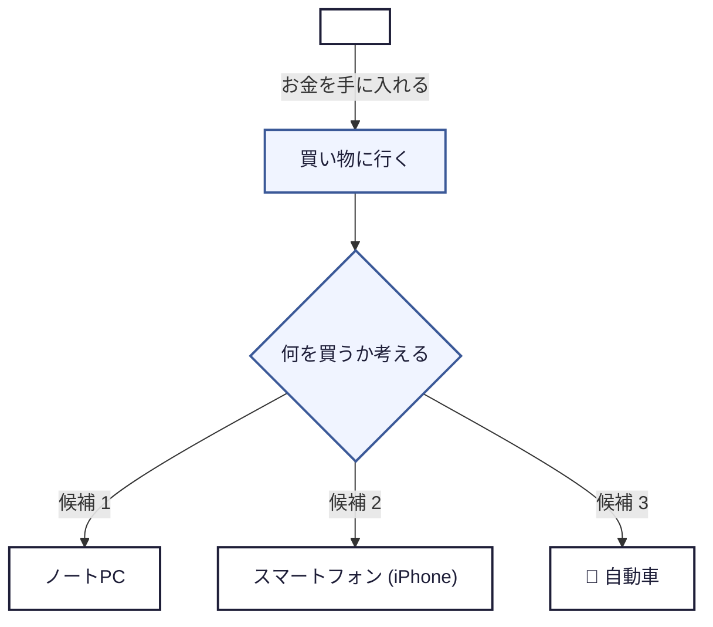
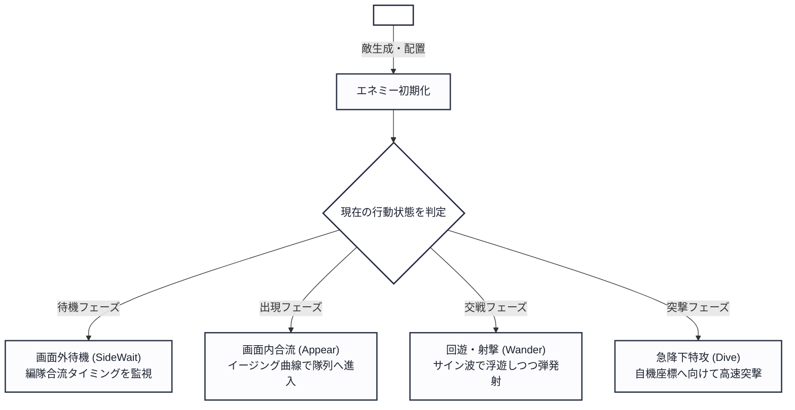
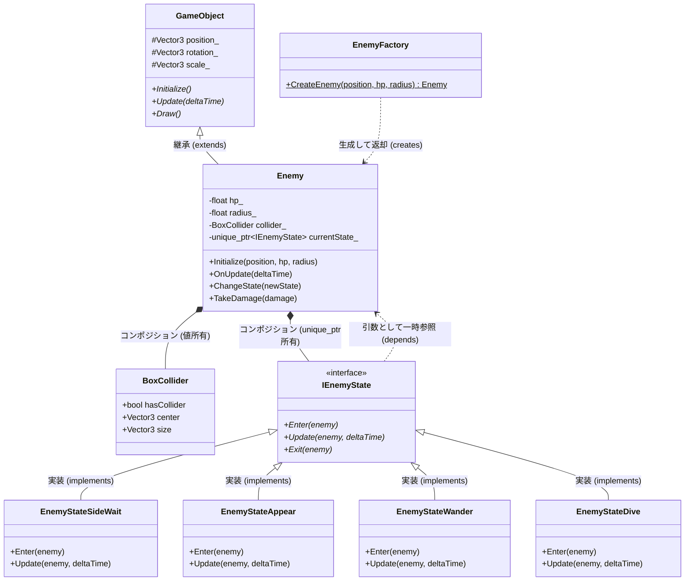
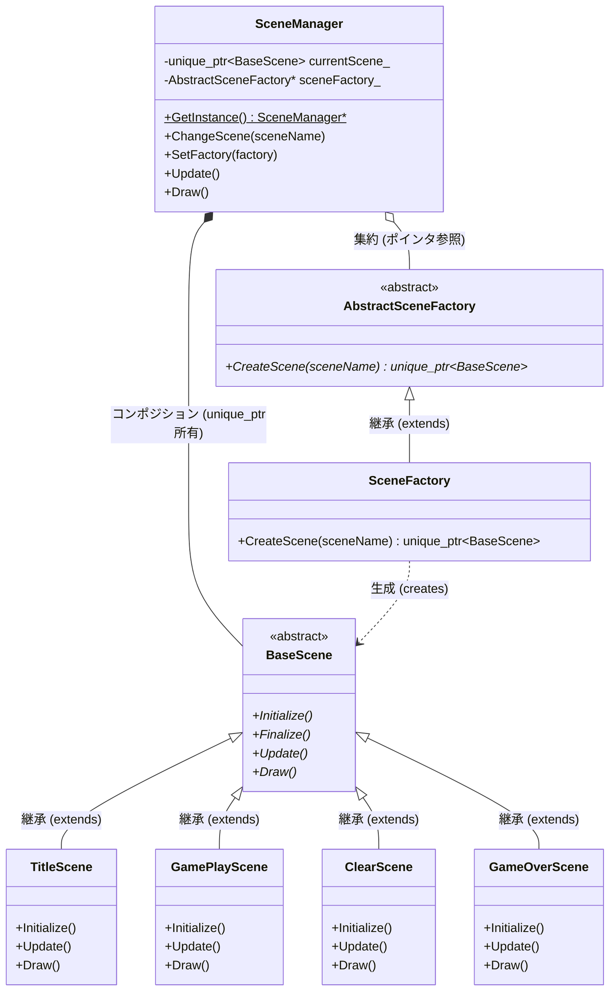

# 【日本工学院 課題提出資料】UMLクラス図 & 設計フロー図

本資料は、就職作品プロジェクト（3Dルート固定シューティング & Blender Sync）におけるクラス設計および振る舞いを、UMLクラス図とフロー図（Mermaid記法）でまとめたものです。

---

## 1. 添付画像の日本語化フロー図 (参考)

ご提示いただいたフロー図の構成・デザインをそのまま日本語化した図です。



---

## 2. プロジェクトのゲーム処理フロー図 (添付画像と同スタイル)

提示画像のスタイル（開始ノード ➔ 処理 ➔ ひし形分岐 ➔ 分岐先カード）を踏襲し、本プロジェクトの「エネミー行動制御AI（Stateパターン）」の処理フローを日本語で視覚化したものです。



---

## 3. 【課題提出用】UMLクラス図 (01_04. デザインパターン / 01_02. ポリモーフィズム)

授業課題の提出要件を満たす正式なUMLクラス図です。

### 判定基準チェック項目
- [x] **継承 (Generalization / Inheritance)**: 三角矢印記号（`<|--`）を使用
- [x] **コンポジション (Composition - 強い所有)**: 塗りつぶし菱形記号（`*--`）を使用
- [x] **集約 (Aggregation - 弱い所有)**: 白抜き菱形記号（`o--`）を使用
- [x] **依存 (Dependency)**: 破線矢印記号（`..>`）を使用
- [x] **関連 (Association)**: 実線矢印記号（`-->`）を使用

---

### パターンA：エネミーAI状態管理（Stateパターン & ポリモーフィズム）※推奨

エネミーの挙動を `IEnemyState` インターフェースを通じてポリモーフィズムで切り替える設計です。



#### 設計のポイント（就活用アピール内容）
1. **State パターンによる状態遷移の分離**:
   - 待機（`SideWait`）、出現（`Appear`）、回遊（`Wander`）、特攻（`Dive`）という異なる行動ルーチンを各Stateクラスへカプセル化。`switch-case` の肥大化を防ぎ、開放閉鎖原則（OCP）を遵守しています。
2. **所有関係（コンポジション）の明確化**:
   - `Enemy` は自身のコリジョン情報 `BoxCollider` を値型として所有（コンポジション）し、状態インスタンス `currentState_` を `std::unique_ptr` で排他的に所有します。
3. **相互参照の疎結合化（依存関係）**:
   - `IEnemyState::Update` 等は引数として `Enemy*` を受け取る一時的な「依存（`..>`）」関係とし、双方向所有による循環参照を回避しています。

---

### パターンB：シーン管理機構（Abstract Factory & Singleton パターン）

シーンの動的切り替えと依存性逆転（DIP）を実現する設計です。



#### 設計のポイント
- **集約（Aggregation: `o--`）**: `SceneManager` は `AbstractSceneFactory` を外部から注入（DI）されてポインタとして保持するため、生存期間が独立した「集約」関係となります。
- **コンポジション（Composition: `*--`）**: 現在アクティブなシーン（`currentScene_`）は `unique_ptr` で完全管理され、切り替え時に破棄されるため「コンポジション」となります。

---

## 4. Mermaid Live Editor での画像出力手順

課題提出物として `.png` 画像が必要な場合の手順です：

1. [Mermaid Live Editor](https://mermaid.live/) にアクセスします。
2. 左側の「Code」ペインに、上記いずれかの ```mermaid ブロック内のコードを貼り付けます。
3. 右側のプレビューに日本語付きの美しいクラス図が表示されます。
4. 画面上部（または下部）の **「Actions」➔「PNG」** をクリックして画像を保存します。
   （または画面をスクリーンショット撮影して保存します）
